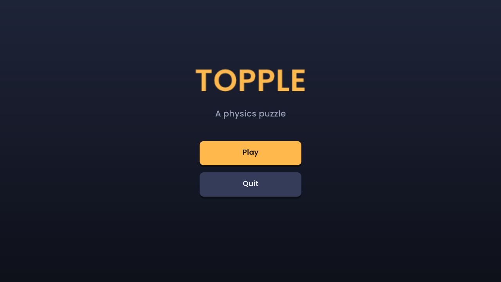
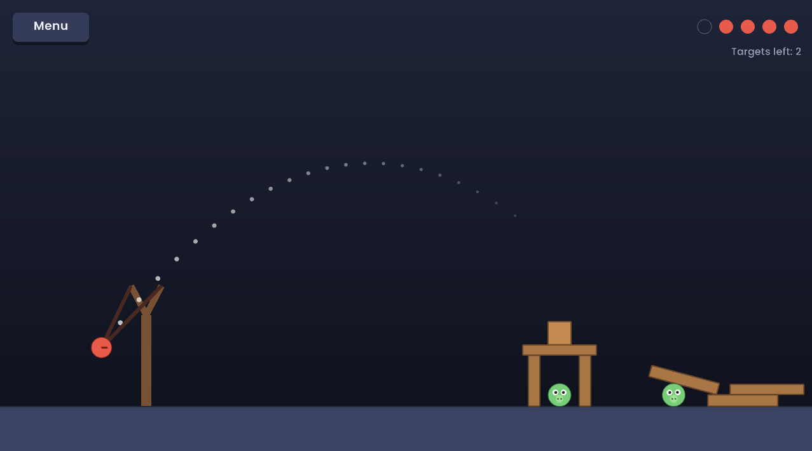

# Topple

A physics puzzle game in the style of Angry Birds, written in C++17 with [raylib](https://www.raylib.com/) and [Box2D](https://box2d.org/).

Drag the ball back in the slingshot, release, and knock down every target before you run out of shots.




## How to play

| Action | Control |
|---|---|
| Aim and fire | Press the ball with the mouse, drag back, release |
| Cancel a shot | Release the ball close to the sling |
| Split a Splitter ball | Click again while it is in the air |
| Pause (Resume, Retry, Levels) | `Esc` |
| Back to level select | The Levels button, or `Esc` once the round is over |
| Mute or unmute sound | `M` |

- Pick a level on the level select screen. Each level gives you a limited number of shots (4 to 6).
- The dotted line previews the flight path. It ignores obstacles, so it shows where the ball goes if nothing is in the way.
- Hard hits damage a target and destroy it. Gentle bumps do nothing.
- Each level gives you its own sequence of balls, shown at the top right (the next one is ringed). The standard ball is red; the **heavy ball** (dark steel) is big and dense and knocks stone over; the **splitter** (yellow) breaks into three pieces when you click in mid-air, to reach spread-out targets.
- Blocks come in four materials: wood (light), stone (heavy, never breaks) and glass (light, cracks on hits and shatters on a hard one). Glass holding up a heavy stone slab is a trap for whatever is underneath.
- Winning earns 1 to 3 stars: 3 if you finish with at least 2 shots to spare, 2 with one spare, 1 otherwise. Your best result per level is saved in `progress.txt` next to the executable.
- You win when every target is gone. You lose when you're out of shots and everything has stopped moving.

## Build and run

Requires CMake 3.15+ and a C++17 compiler. raylib and Box2D are downloaded by CMake on the first configure, so the first build needs an internet connection.

```
cmake --preset mingw        # or: cmake --preset default
cmake --build build -j 8
cmake --build build --target run
```

Presets: `default`, `debug`, and `mingw` (MinGW Makefiles generator, used on Windows with a MinGW-w64 toolchain; the executable is linked statically so it needs no DLLs).

On Linux you need the X11 and OpenGL development packages:

```
sudo apt-get install libx11-dev libxrandr-dev libxinerama-dev libxcursor-dev libxi-dev libgl1-mesa-dev
```

The game loads fonts relative to the executable (`resources/` is copied next to it at build time), so it runs from any folder.

## Project layout

```
src/
  app/      App, Scene interface, SceneManager, AppContext, Pointer (mouse state)
  audio/    SoundBank (plays effects) and synth (generates them from oscillators and noise)
  physics/  Box2D wrapper: pixels <-> metres, fixed time step, collision impacts
  game/     Level, LevelDef + levels.cpp (level data), Progress (saved stars), rating, Block (+ BlockKind materials), Ball (+ BallKind), Target, Slingshot, Effects
  ui/       Theme (palette, fonts), Button, ChoiceDialog (choice buttons, stars), star drawing
  scenes/   MenuScene, LevelSelectScene, PlayScene (the rules: shots, win and lose)
resources/
  fonts/    Poppins
```

Design notes:

- **Scenes.** The `SceneManager` holds the active scene and applies replacements at the start of the next frame, so a scene can safely ask to be replaced from inside its own update.
- **Physics is isolated.** Only `physics/` knows about Box2D units. Everything else works in pixels with y pointing down, like the screen. The simulation runs on a fixed 60 Hz step, so it behaves the same at any frame rate.
- **Level vs. rules.** `game::Level` owns the physics world and everything in it. `PlayScene` owns the rules and the UI. Levels are plain data (`LevelDef`, built with a small `Builder` in `levels.cpp`), so adding one means adding a function there, not touching the rules.
- **Ball kinds.** Like materials, a ball's size, weight and colour come from one table in `ball.cpp`. A level's `ammo` is just a list of `BallKind`s, and `Level::TriggerAbility` handles the split, so `PlayScene` only forwards the click.
- **Materials in one table.** What a block is made of (`BlockKind`: wood, stone, glass) decides its density, colour and whether it breaks. That table lives in `block.cpp`, so a new material is one entry plus a switch case, and level data only names the kind.
- **Sound without files.** The effects are synthesised in `audio/synth.cpp` (sine tones, filtered noise), so there are no audio assets or licences to manage. `Level::Update` reports what happened (targets destroyed, strongest impact) and `PlayScene` decides which sounds to play.
- **Input.** Game objects such as the `Slingshot` receive a `Pointer` struct instead of polling raylib, and report what happened (a `Launch`) instead of creating bodies themselves.

## Credits

- [raylib](https://www.raylib.com/) by Ramon Santamaria and contributors (zlib license): windowing, drawing, input.
- [Box2D](https://box2d.org/) 2.4.1 by Erin Catto (MIT license): 2D physics.
- [Poppins](https://fonts.google.com/specimen/Poppins) by Indian Type Foundry (SIL Open Font License; see `resources/fonts/OFL.txt`): UI font.
